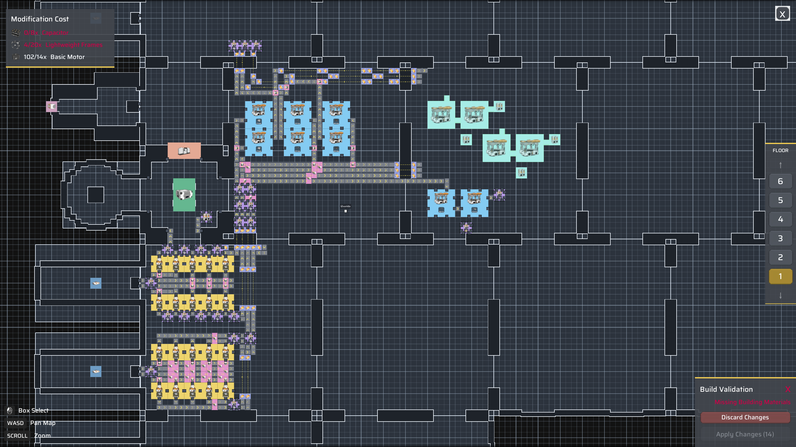
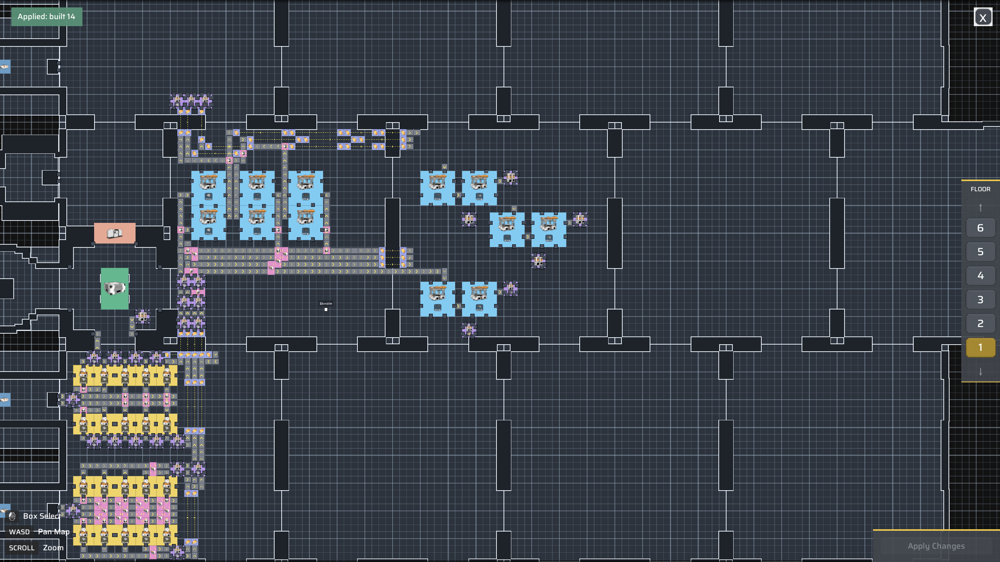
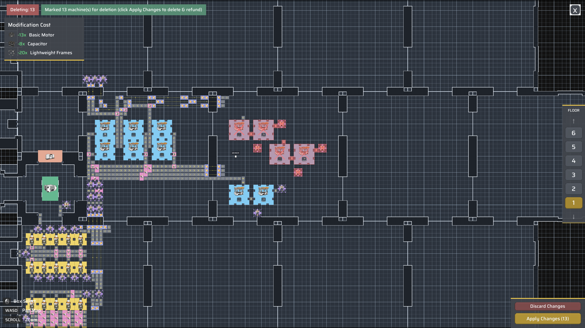

# Elvenide's Station Map

**Elvenide's Station Map** is an interactive fullscreen 2D station map for **Main Sequence** with floor switching, live machine/player tracking, copy-paste, delete, and ghost build planning, built with UE4SS Lua.

It is designed to feel native to the base game—matching its exact UI style—and is **100% save-safe and removable** without adding custom items, machines, or save dependencies.

## Getting Started

- **[Getting Started & Installation Guide](docs/get-started.md)**

## Full Station Map UI

View your entire space station floor-by-floor in a fullscreen 2D map with native-style floating overlays, inspect machines/ports/walls/players, delete machines, and copy-paste full machine layouts with staged ghost previews, live Modification Cost tracking, and Build Validation.

### Opening the Station Map

- Press **`N`** (default) while on foot in a space station to toggle the fullscreen **Station Map** (or press **`Escape`** / click the top-right **`X`** button to close it).
- A **Station Map** keybind indicator also appears in the top-right HUD alongside **Power (`P`)** and **Logistics (`L`)** while on foot in a station, updating automatically if you rebind the key.
- You can rebind this key in **Settings → Controls** under **Station Map** (stored in `ElvenidesStationMap/config.json` as `"StationMapKey"`).

### Features

- **Fullscreen Floor-by-Floor 2D Top-Down View**:
  - Displays station modules, interior walls and doorways, built machines, directional conveyors, underground belt pairs, item ports, and enlarged live player markers on the active floor.
  - **Pan & Zoom**: Pan with **`WASD` / Arrow keys** (or **`Space` + Left-Click Drag**), and zoom smoothly around the cursor with the **Mouse Wheel**.
  - **Floor Navigation**: Use the floating vertical numbered floor rail on the right side (`1`, `2`, `3`, …) with `↑` / `↓` pagination buttons to switch between floors.
  - **Contextual Keybind Legend & Status Pills**: Floating bottom-left keybind badges adapt to your current selection/paste mode, while top-left pills show active mode and pending change counts.
- **Machine Icons & Hover Tooltips**:
  - Assemblers, refineries, containers, and conveyor belts display icons for the item they are producing, storing, or moving.
  - Hover over any machine or port to view a detailed tooltip (machine type, recipe/item, port direction/filter/enabled state, and priority).
- **Selection, Box-Select & Deletion (`X`)**:
  - Click a machine to select it, **`Shift` + Click** to toggle multiple machines in the selection, or **Left-Click and drag** to box-select a group of machines.
  - Press **`X`** to stage selected machines for disassembly -- normal material refunds apply when changes are applied.
- **Copy-Paste, Rotate (`R`), Smart Replace (`⇄`) & Ghost Staging**:
  - Press **`Ctrl+C`** to copy the selected machine(s) and their relative layout -- including **recipes, splitter/balancer filters, input/output priorities, disabled ports, and underground belt distances**.
  - Press **`R`** to rotate the ghost preview by 90° clockwise before placing, or **Right-Click (`RMB`)** / **`Escape`** to cancel Paste mode.
  - Click on any floor to stage ghost placements freely (even while short on materials, matching Ship/Station Designer workflow). Pasting over an existing machine of a different type or orientation stages a **Smart Replace (`⇄`)** that disassembles the old machine and builds the new one cleanly, crediting the refunded materials toward net costs.
  - Staged ghosts persist for the current session across map close/reopen and automatically revalidate against newly placed or removed machines.
- **Modification Cost, Build Validation & Apply Changes**:
  - A floating **Modification Cost** panel lists net required materials and refunds (highlighting missing items in red), paired with a **Build Validation** panel when materials are missing.
  - Click **Apply Changes** to commit all staged builds/deletes/replacements natively via the game's build and disassemble commands (consuming/refunding normal inventory materials), or **Discard Changes** to cancel all pending edits.

### Examples

*Staged ghost placements on Floor 1 with the Modification Cost panel highlighting missing materials in red and Build Validation blocking Apply Changes until supplies are available.*

*Floor 1 immediately after clicking Apply Changes, showing all 14 newly built machines rendered live on the map.*

*13 machines marked for deletion in red, with the Modification Cost panel previewing the refunded materials before applying.*

### Notes

- The Station Map hasn't been tested in very large stations. If you're experiencing performance issues on the Station Map in a large station, you can try avoiding fully zooming out on the Station Map. The map only loads what's visible, so zooming out fully will cause it to try to render the entire floor of your station -- which could be slow or nonperformant. In personal testing on my medium-sized station, FPS drops from 120 to 90 while rendering a zoomed out Station Map.

## Credits

**Elvenide's Station Map** is created and maintained by Elvenide. This is an unofficial mod and I'm not affiliated with Main Sequence.

> If you have questions or run into issues, feel free to reach out in #modding-guides within the [official Main Sequence Discord server](https://discord.com/invite/uy8w2pTcQE).
